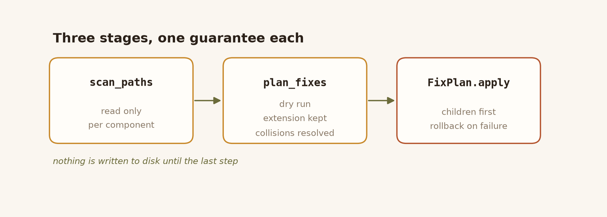
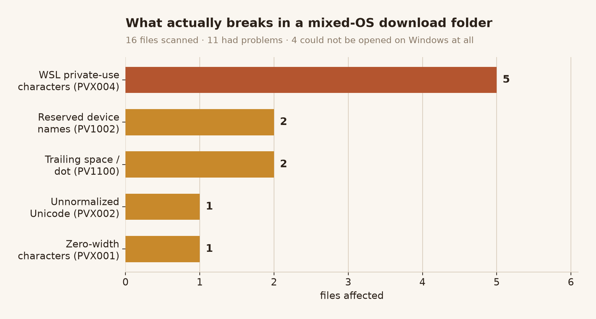
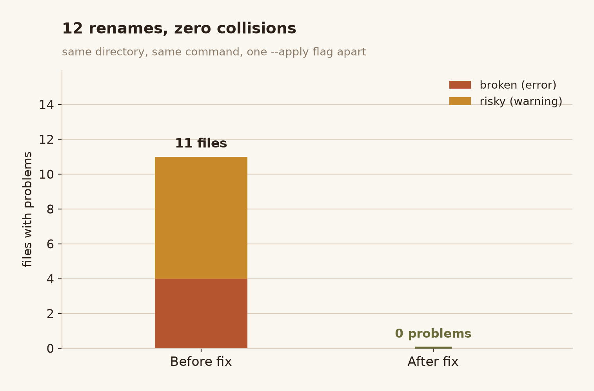

# pathvalidate + pvscan

A fork of [thombashi/pathvalidate](https://github.com/thombashi/pathvalidate) that
adds **batch scanning and safe renaming** of directory trees, plus a `pvscan`
command line tool.

The upstream library answers *"is this one file name valid for platform X?"*.
This fork answers the next question: *"I have 40,000 files downloaded from three
operating systems — which ones will break, and can you fix them without
clobbering each other?"*



---

## What was added

Everything here is **additive**. No upstream validation rule, error message,
error code or function signature was changed. `test/test_batch.py` asserts this
directly (`Test_public_api::test_upstream_behaviour_is_unchanged`).

### Five problems the upstream single-name API cannot express

| # | Problem | What this fork does |
| --- | --- | --- |
| 1 | **Truncation eats the extension.** `sanitize_filename("a"*250 + ".tar.gz", max_len=255)` returns `"…aaa.tar"` — the file loses `.gz` and stops being an archive. | `fit_length` splits off the compound extension first, then spends the byte budget on the stem. `"a"*248 + ".tar.gz"`. |
| 2 | **Sanitization creates collisions.** `a:b` and `a\|b` both become `a_b` on Windows. Applied in a loop, the second rename silently fails or overwrites. | `plan_fixes` groups by parent directory, tracks taken names case-insensitively, and disambiguates: `a_b`, `a_b (2)`. |
| 3 | **WSL names pass validation but are broken.** WSL stores `\| : * ? < >` that NTFS forbids as private-use characters at `U+F000`. They are perfectly "valid" to any validator, then break on copy. | New issue code `PVX004`; `decode_wsl_name()` reverses the mapping before sanitizing. |
| 4 | **Trailing space/dot files are unreachable.** Windows strips them from ordinary paths, so `os.rename("report. ", …)` raises `FileNotFoundError` even though the file exists. | Renames fall back to the `\\?\` extended-length prefix. Verified against a real file named `"lead "`. |
| 5 | **Parent renamed before child.** Renaming `sub:dir` first invalidates `sub:dir/inner.log`, which still needs fixing. | Renames are sorted deepest-first. |

### Also added

- **Per-component reporting.** A bad directory name is reported once, not once per
  file inside it.
- **`PVX001` invisible characters** (zero-width space, bidi overrides) and
  **`PVX002` unnormalized Unicode** (NFD `café` vs NFC `café`), both as warnings.
- **Terminal-safe output.** Names are escaped (`\u200b`, `\uf03a`) so a report can
  actually be acted on — otherwise `a|b.txt` and `ab.txt` print identically.
- **Rollback.** If rename #7 of 10 fails, the first 6 are reverted and
  `BatchRenameError` is raised.
- **`--matrix`** on `check`: one pass, verdict per platform (Windows / macOS /
  Linux / universal).
- **Exit codes**: `0` clean, `1` problems, `2` usage error, `3` apply failed.

---

## Usage

```console
$ pip install .
$ pvscan --help
```

### What it finds



The five WSL-mapped names are the interesting ones: they pass every validator
that exists, because on disk they really are legal Unicode. They only break when
the file leaves the machine.

### Check (always read only)

```console
$ pvscan check ./downloads --platform windows
./downloads  (target: Windows)
CON.txt
  ERROR PV1002 RESERVED_NAME component='CON.txt'
        [PV1002] found a reserved name by a platform: 'CON' is a reserved name, ...
a\uf07cb.txt
  WARN  PVX004 WSL_MAPPED_CHARACTER component='a\\uf07cb.txt'
        character(s) remapped into the Unicode private use area by WSL, original name is 'a|b.txt'
sub\uf03adir  [dir]
  WARN  PVX004 WSL_MAPPED_CHARACTER component='sub\\uf03adir'
        character(s) remapped into the Unicode private use area by WSL, original name is 'sub:dir'
.: 4 scanned, 1 invalid, 4 with issues
```

### Fix (dry run unless `--apply`)

```console
$ pvscan fix ./downloads --platform windows
./downloads: 4 rename(s) planned
  'x\uf03c1\uf03e.log' -> 'x_1_.log'  (sanitize)
  'CON.txt' -> 'CON_.txt'  (sanitize)
  'a\uf07cb.txt' -> 'a_b.txt'  (sanitize)
  'sub\uf03adir' -> 'sub_dir'  (sanitize)
dry run: re-run with --apply to perform these renames

$ pvscan fix ./downloads --platform windows --apply
applied 4 rename(s)
```

Re-running is a no-op:

```console
$ pvscan fix ./downloads --platform windows --apply
./downloads: nothing to fix (5 entries checked)
```



### From Python

```python
from pathvalidate import scan_paths, plan_fixes

result = scan_paths("./downloads", platform="windows")

for report in result.reports:
    for issue in report.issues:
        print(report.relative, issue.code, issue.kind)

plan = plan_fixes(result)          # no filesystem changes
for rename in plan:
    print(rename.source.name, "->", rename.target.name, rename.reasons)

plan.apply()                       # renames children first, rolls back on failure
```

---

## Verification

Run everything with:

```console
$ python tools/verify/run_all.py
```

Eight steps, all currently passing:

| Step | Result |
| --- | --- |
| Line endings normalized to LF | 102 files converted, LICENSE sha256 == upstream blob `130a35b9…` |
| Upstream files untouched | 90 of 96 byte identical; 6 changed, all documented in `NOTICE.md` |
| Python 3.9 syntax compatibility | 3 new files parse with the 3.9 grammar, no eager generics |
| Compatibility checker is discriminating | 3 real 3.9 breakages caught, 2 legal constructs passed |
| Full test suite | **4247 passed, 14 skipped** (baseline: 4170 passed, 14 skipped) |
| Lint (real errors only) | `ruff --select F,E9,I001` clean on all new files |
| Type check | `mypy` clean on `batch.py` and `_cli.py` |
| Mutation testing | **8/8** mutations killed |

### Why the numbers can be trusted

- **The baseline was measured first.** The untouched upstream tree gave
  `4170 passed, 14 skipped`; after the change `4247 passed, 14 skipped`. The 77
  new tests are the only delta, and the same 14 tests are skipped for the same
  reasons.
- **Mutation testing, not just a green suite.** Each mutation deletes one
  behaviour (extension-preserving truncation, collision resolution, WSL decoding,
  bottom-up ordering, extended path prefix, rollback, WSL detection, invisible
  character detection). All 8 turn the suite red. A green suite alone would not
  prove the tests can fail.
- **The compatibility checker was itself tested.** The first version silently
  passed everything, including `return list[int]` which really breaks on 3.9.
  It was fixed and then fed three known-bad and two known-good samples.
- **End-to-end from the built wheel.** A clean virtualenv, `pip install
  dist/*.whl`, then `pvscan check` → `fix --apply` → `check` returning `0 invalid`.
  This is what caught the missing `fallback_version`: without it, the ZIP has no
  `.git` directory and `setuptools_scm` refuses to build.

### Bugs found and fixed during development

These were all discovered by running the tool, not by reading the code:

1. **Every entry reported its whole path.** A broken directory produced one
   warning per contained file. Fixed by reporting only the leaf component.
2. **`os.path.abspath()` stripped the trailing dot.** `trail.` became `trail`,
   so the "repair" renamed a file onto itself. Fixed by joining path components
   without normalization.
3. **WSL names were not decoded before sanitizing.** The private-use characters
   survived and the repaired name stayed broken.
4. **`os.sys` instead of `sys`** — works at runtime, flagged by mypy.
5. **`setuptools_scm` failed on a ZIP without `.git`.** Added `fallback_version`.

---

## Known limitations

- **`check` on a file (not a directory)** reports the file's own name only; it
  does not check whether the parent directories are portable.
- **Symlinked directories** are not descended into by default (`--follow-symlinks`
  opts in), and their names are never rewritten, to avoid renaming the target.
- **Case-only renames** (`README.MD` → `readme.md`) go through a temporary name,
  which is not atomic on a crash.
- **`PVX001` / `PVX002` are warnings, not errors.** They do not affect the exit
  code unless `--fail-on warning` is used.
- **Python 3.9 compatibility is verified statically**, because only 3.13 is
  installed locally. The suite has not actually been executed on 3.9.

---

## License

MIT, identical to upstream. `LICENSE` is byte-for-byte the upstream file
(sha256 `130a35b917df1951aefbf366120491d5124045a87ded123f20ded21521f4e3a2`).

Modifications are documented in [`NOTICE.md`](NOTICE.md), as the MIT license
requires the copyright notice to be preserved and changes to be stated.

Original: Copyright (c) 2016-2025 Tsuyoshi Hombashi.
